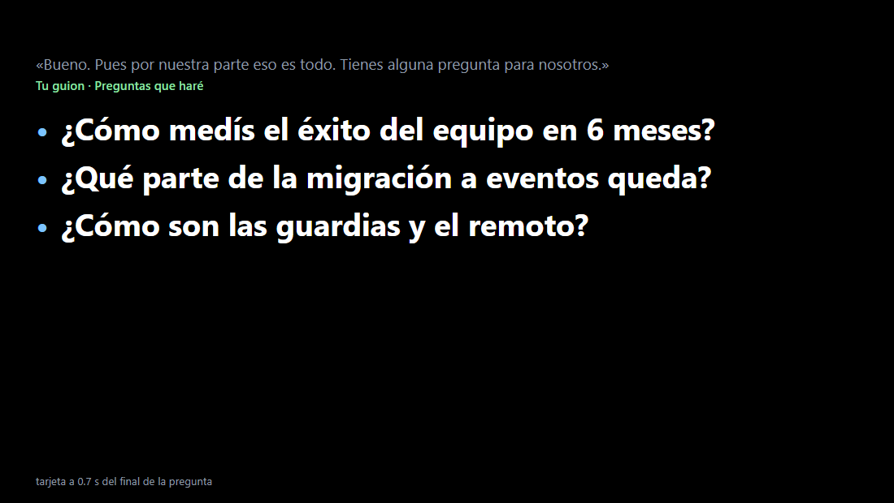

# Apuntador de entrevistas (prototipo EN-01)

Durante una entrevista por videollamada, cuando el entrevistador acaba una
pregunta, aparece una tarjeta con **3 puntos clave** para tu respuesta:

- si la pregunta está en tu guion (aunque la diga con otras palabras), **tus
  propios puntos**, al instante;
- si no, los que propone un **modelo local** (Ollama) a partir de tu guion,
  tu CV, la oferta y las notas de la empresa. Lo que añade por su cuenta sale
  marcado *(sugerencia)*.

Todo es local: el audio va a Hex en tu equipo y el texto a Ollama en tu
equipo. No modifica Hex; usa su API `/streams`
([`docs/streams.md`](../../docs/streams.md)). Sólo biblioteca estándar de
Python.

```ts
audio del entrevistador ─► Hex /streams (Nemotron, GPU) ─► apuntador.py
                                                            ├── ¿ha acabado una pregunta?
                                                            ├── ¿está en tu guion? ─► tus puntos
                                                            └── si no ─► Ollama (prefijo fijo: guion + CV + oferta + notas)
                                                                         └─► página http://127.0.0.1:8766/
```



## Escribe tu guion

Copia [`plantilla-guion.md`](plantilla-guion.md) y rellénala; las
instrucciones están dentro. Pon a su lado, en la misma carpeta, tu CV, la
oferta y tus notas de la empresa como `.md` o `.txt` (los lee todos). En
[`ejemplo/`](ejemplo/) hay un caso completo, ficticio: Alex García, backend,
entrevista en "Rutalia".

Lo más importante de la plantilla:

- **Preguntas previstas**: cada una con `###`, una línea `También:` con
  otras formas de decirla (separadas por `/`) y 3 viñetas con tus puntos.
  El reconocimiento compara palabras, así que cuantas más variantes, mejor
  ("cuánto quieres cobrar / qué sueldo buscas / rango salarial").
- **Preguntas que haré**: salen solas cuando te preguntan "¿tienes alguna
  pregunta para nosotros?".
- Ideas cortas, no frases: tienes un segundo para leerlas.

## Cómo probarlo

```powershell
# 1. Modelo local (una vez)
ollama pull gemma4:12b

# 2. Entrevista simulada: WAV con la voz de Windows (Helena, es-ES) y sus tiempos
py make_wav.py ejemplo/entrevista.json --out ejemplo/entrevista.wav

# 3. Con Hex: el WAV suena "como el entrevistador" a velocidad real
py apuntador.py --wav ejemplo/entrevista.wav --model gemma4:12b --open

# 4. Sin Hex: repite la transcripción de una sesión grabada
py apuntador.py --replay resultados/con-guion/segmentos.jsonl --model gemma4:12b --open

py -m unittest -v test_apuntador.py    # detección de preguntas y del guion
py informe.py resultados/solo-modelo/*.json   # tablas de esta página
```

Opciones útiles: `--guion mi-guion.md`, `--contexto cv.md oferta.md`,
`--discovery <local-api.json>` (qué Hex usar; por defecto el de
`%APPDATA%\hex`), `--solo-modelo` (pregunta al modelo también lo que está en
el guion, para comparar modelos), `--cold` (descarga los modelos antes, para
medir la carga), `--out carpeta` (guarda resultados JSON). En la página,
`?size=40` cambia el tamaño de letra.

Hex sólo admite un stream a la vez. Para no tocar tu MicroPrompt diario, las
medidas usaron una copia aparte del fork (la compilación `release` de `main`)
con su propia carpeta y sin atajos:
`HEX_APPLICATION_SUPPORT_DIR=<carpeta propia>`, `HEX_STREAM_ATT_RIGHT=3`,
`HEX_DISABLE_UPDATES=1`, `hex.exe app --hidden`, y `--discovery` apuntando a
su `local-api.json`.

Falta el audio real: hoy el apuntador recibe un WAV. Capturar el audio del
sistema (lo que dice el entrevistador) y el micrófono (tú) es trabajo de
EN-02/EN-03 en la app.

## Medido

8 de noviembre de 2026, Windows 11, RTX 5070 Ti (16 GB), Ollama 0.40.15.
Entrevista simulada de 2:29 min con la voz Helena: 13 turnos del
entrevistador, 10 preguntas (6 de tu guion dichas con otras palabras, 4
imprevistas: 2 de comportamiento, 1 técnica, 1 de opinión) y 3 frases que no
son preguntas, con 8 s de silencio tras cada pregunta (tu respuesta). Pasó
por Hex de verdad (Nemotron 3.5, español, GPU, R=3), así que las preguntas
llevan los errores y los tiempos reales de la transcripción.

El tiempo se cuenta desde que el entrevistador **deja de hablar** (medido
en el WAV) hasta que la tarjeta muestra los 3 puntos. Incluye la
transcripción: Hex entrega la frase cerrada unos 0,65 s después del final
de la voz (corta en una pausa de 0,6 s).

### Detección

Igual en todas las pasadas:

- **9 de 10 preguntas** sacaron tarjeta. La que falló: Nemotron oyó
  "Quería si a mitad de un sprint…" en lugar de "¿Qué harías si…?", sin
  signos de interrogación.
- **0 de 3** frases que no son preguntas sacaron tarjeta ("Vale, perfecto",
  "Te cuento un poco del puesto…").
- **6 de 6** preguntas del guion se reconocieron aunque se dijeron con otras
  palabras ("¿Cuánto te gustaría cobrar?" → *expectativas salariales*), y
  ninguna imprevista se confundió con una del guion.
- Nemotron **casi nunca escribe los signos de interrogación** en estas
  frases ("Para empezar, me haces un pequeño resumen…", "Tienes alguna
  pregunta para nosotros."). Por eso el apuntador reconoce también cómo
  empieza cada frase: "me haces…", "cómo…", "cuéntame…", "tienes…".

### Modelos

Los tres, preguntados en las 9 preguntas detectadas (`--solo-modelo`), cada
uno cargado en frío. Junto a Hex con Nemotron en la misma GPU.

| Modelo | VRAM del modelo | GPU en total (pico) | Carga en frío | 1.er punto (mediana / peor) | 3 puntos (mediana / peor) | ≤ 4 s |
| --- | ---: | ---: | ---: | ---: | ---: | ---: |
| qwen3.5:4b | 3,8 GB | 7,8 GB | 2,6 s | 0,9 / 1,8 s | 1,1 / 2,1 s | 9 de 9 |
| qwen3.5:9b | 6,3 GB | 10,3 GB | 4,0 s | 0,9 / 1,4 s | 1,2 / 1,6 s | 9 de 9 |
| gemma4:12b | 8,6 GB | 14,3 GB | 16,9 s | 1,1 / 6,2 s | 1,2 / 6,3 s | 8 de 9 |
| gemma4:12b, con el arranque corregido | 8,6 GB | 12,7 GB | 5,3 s | 1,1 / 1,3 s | 1,2 / 1,4 s | 9 de 9 |

- **Los tres llegan de sobra**: unos 1,2 s desde el final de la pregunta
  (0,65 s de transcripción y ~0,5 s del modelo). El objetivo era 4 s.
- **Con tu guion es aún más rápido**: los puntos salen a los 0,65 s, en
  cuanto llega la frase (`resultados/con-guion/`).
- El peor caso de gemma4 (6,3 s) fue **la primera pregunta tras cargarlo**.
  Calentar el modelo al arrancar con una respuesta entera (no con un solo
  token) lo quita: en la pasada siguiente la primera tardó 1,4 s
  (`resultados/arranque/`, sin Hex, con la transcripción grabada). Ya está
  corregido en `apuntador.py`.
- "VRAM del modelo" es lo que subió `nvidia-smi` al cargarlo (Ollama
  informa de 1,1 GB para gemma4, que no es real). "GPU en total" incluye
  Windows, esta copia de Hex **y otra copia de Hex de otra prueba que corría
  a la vez**; en tu uso real calcula unos 3 GB (Windows y Hex con Nemotron)
  más el modelo: ~9,3 GB con qwen3.5:9b y ~11,6 GB con gemma4:12b, más lo
  que use la app de videollamada.
- Carga en frío: la primera vez desde disco tarda más (29 s qwen3.5:4b,
  17 s gemma4). Con `keep_alive` se queda cargado 30 min.
- Prefijo fijo (instrucciones, guion, CV, oferta, notas: ~1.550 tokens) y
  `num_ctx` 3072: Ollama sólo lee la pregunta nueva cada vez.

### Las respuestas, para que las puntúes

Pon una nota del 1 al 5 a cada fila: ¿te ayudaría a contestar? Tiempo = de
fin de pregunta a 3 puntos en pantalla.

#### 1. «Para empezar, me haces un pequeño resumen de tu trayectoria profesional.»

Del guion: *Háblame de ti* (reconocida).

| Modelo | Puntos | Tiempo | Tu nota (1–5) |
| --- | --- | ---: | --- |
| qwen3.5:4b | 7 años backend en Python y Go, logística y pagos · Tech lead en Pagaflux con equipo de 4 personas · Me obsesiona medir SLOs y latencia (sugerencia) | 2,1 s |  |
| qwen3.5:9b | 7 años backend con Python y Go · Logística (TransLeón) y pagos (Pagaflux) · Lidero 4 personas; me obsesiona medir | 1,2 s |  |
| gemma4:12b | 7 años backend, Python y Go · Experiencia en logística y pagos · Lidero equipo de 4 personas | 6,3 s* |  |

\* primera pregunta tras cargarlo; con el arranque corregido, 1,4 s.

#### 2. «Vale. Perfecto, muy interesante. ¿Y qué es lo que te ha llamado la atención de nuestra empresa?»

Del guion: *¿Por qué quieres trabajar en Rutalia?* (reconocida).

| Modelo | Puntos | Tiempo | Tu nota (1–5) |
| --- | --- | ---: | --- |
| qwen3.5:4b | Vuestra migración a eventos con Kafka coincide exactamente con mi experiencia en Pagaflux. · El enfoque de medir antes de opinar me recuerda cómo trabajo para optimizar rutas. · Quiero aplicar mis conocimientos de logística a un producto con impacto físico real. | 1,2 s |  |
| qwen3.5:9b | Vuelvo a logística con mi optimizador de rutas · Vuestra migración a eventos = lo que hice en pagos · Producto con impacto visible: entregas reales | 1,2 s |  |
| gemma4:12b | Vuelvo a logística y optimización de rutas · Vuestra migración a eventos con Kafka · Producto con impacto físico y visible | 1,3 s |  |

#### 3. «Cuéntame una situación en la que tuviste un conflicto con un compañero y cómo lo resolviste.»

Imprevista.

| Modelo | Puntos | Tiempo | Tu nota (1–5) |
| --- | --- | ---: | --- |
| qwen3.5:4b | Conflicto por plazos imposibles en Pagaflux (sugerencia). · Propuse fases mínimas usando datos de riesgo. · Lanzamos fase 1 a tiempo sin horas extra. | 0,9 s |  |
| qwen3.5:9b | Conflicto por plazo imposible con producto en Pagaflux · Propuse versión mínima y fases con datos de riesgo · Lanzamos fase 1 a tiempo sin horas extra | 1,0 s |  |
| gemma4:12b | Conflicto con producto por plazo imposible · Propuse versión mínima y fases con datos · Lanzamos a tiempo sin horas extra | 1,1 s |  |

#### 4. «Hablame de algún proyecto que hayas liderado y que saliera especialmente bien.»

Del guion: *Cuéntame un proyecto del que estés orgulloso* (reconocida).

| Modelo | Puntos | Tiempo | Tu nota (1–5) |
| --- | --- | ---: | --- |
| qwen3.5:4b | Migración a eventos con Kafka redujo incidencias un 40 % · Diseñé idempotencia para evitar cobros duplicados en Black Friday · Lideré el equipo y formé a los nuevos miembros del proyecto (sugerencia) | 1,1 s |  |
| qwen3.5:9b | Migración de cobros a eventos con Kafka en Pagaflux · Redujimos incidencias un 40 % y eliminamos duplicados · Lideré el diseño técnico y formé al equipo | 1,0 s |  |
| gemma4:12b | Migración de cobros a eventos con Kafka · Reducción del 40% en incidencias · Cero cobros duplicados en 18 meses | 1,1 s |  |

#### 5. «Como diseñarías un sistema para que los repartidores reciban los cambios de ruta en tiempo real.»

Imprevista, técnica.

| Modelo | Puntos | Tiempo | Tu nota (1–5) |
| --- | --- | ---: | --- |
| qwen3.5:4b | Migrar el planificador actual a microservicios con Kafka como cola central. · Enviar eventos de actualización de rutas directamente a la app móvil. · (sugerencia) Medir latencia de entrega y coste por pedido para validar el diseño. | 1,1 s |  |
| qwen3.5:9b | Kafka como cola centralizada para eventos de ruta (sugerencia) · WebSocket empujando actualizaciones a la app móvil del repartidor · Medir latencia de entrega y tasa de mensajes perdidos (sugerencia) | 1,3 s |  |
| gemma4:12b | Arquitectura basada en eventos con Kafka · Consumidores en tiempo real para la app · Garantizar idempotencia y baja latencia (sugerencia) | 1,2 s |  |

#### 6. «¿Qué harías si a mitad de un sprint te cambian las prioridades y no vas a llegar a la fecha de entrega?»

Imprevista. **No sacó tarjeta**: la transcripción fue "Quería si a mitad
de un sprint…". Para poder puntuarla, se preguntó aparte con el texto
correcto; el tiempo es sólo el del modelo.

| Modelo | Puntos | Tiempo | Tu nota (1–5) |
| --- | --- | ---: | --- |
| qwen3.5:4b | Analizar el impacto en los SLOs actuales y métricas clave como latencia. · Proponer una versión mínima viable con datos de riesgo para negociar plazos. · (Sugerencia) Usar un diagrama de Gantt actualizado para visualizar las nuevas dependencias. | 0,5 s |  |
| qwen3.5:9b | Evaluar impacto real en SLOs y coste por pedido. · Proponer versión mínima viable con datos de riesgo. · Delegar tareas críticas para cumplir plazos ajustados. | 0,5 s |  |
| gemma4:12b | Analizar impacto y riesgos con datos · Proponer versión mínima viable (MVP) · Negociar fases con el equipo de producto | 0,5 s |  |

#### 7. «¿Y qué es lo que te hace querer cambiar de empresa justo ahora?»

Del guion: *¿Por qué quieres dejar tu trabajo actual?* (reconocida).

| Modelo | Puntos | Tiempo | Tu nota (1–5) |
| --- | --- | ---: | --- |
| qwen3.5:4b | La plataforma actual ya está muy madura y estable. · Quiero volver a retos de optimización logística pura. · Busco un nuevo problema con impacto físico real (sugerencia). | 0,9 s |  |
| qwen3.5:9b | Plataforma de cobros ya madura y estable · Quiero problemas de optimización otra vez · Nada negativo: buen equipo, crecí mucho | 0,9 s |  |
| gemma4:12b | Plataforma de cobros actual ya madura · Busco problemas de optimización logística · Crecimiento personal en Pagaflux fue excelente | 0,9 s |  |

#### 8. «¿Qué opinas de usar inteligencia artificial para escribir código en el día a día?»

Imprevista, de opinión: aquí el modelo tiene que tirar de conocimiento
general.

| Modelo | Puntos | Tiempo | Tu nota (1–5) |
| --- | --- | ---: | --- |
| qwen3.5:4b | Uso Copilot para generar boilerplate y pruebas, pero reviso siempre la lógica crítica (sugerencia). · Me enfoco en entender el problema antes de pedirle código al modelo. · La IA es una herramienta de productividad, no reemplaza mi criterio técnico. | 0,8 s |  |
| qwen3.5:9b | Uso IA para generar boilerplate y pruebas unitarias (sugerencia) · Reviso siempre la lógica antes de integrar cambios (sugerencia) · Me enfoco en arquitectura y métricas, no en sintaxis (sugerencia) | 1,1 s |  |
| gemma4:12b | Aumenta productividad en tareas repetitivas · Riesgo de errores en lógica compleja (sugerencia) · Importante revisar código y seguridad (sugerencia) | 0,9 s |  |

#### 9. «Hablemos de dinero. ¿Cuánto te gustaría cobrar?»

Del guion: *¿Cuáles son tus expectativas salariales?* (reconocida).

| Modelo | Puntos | Tiempo | Tu nota (1–5) |
| --- | --- | ---: | --- |
| qwen3.5:4b | Rango 58–64 k brutos anuales. · Flexible si hay remoto y formación. · Primero entender el puesto completo (sugerencia). | 1,4 s |  |
| qwen3.5:9b | Rango 58–64 k brutos anuales · Flexible si hay remoto y formación · Primero entender el puesto completo (sugerencia) | 1,6 s |  |
| gemma4:12b | Rango 58–64 k brutos · Flexible con remoto y formación · Primero entender el puesto completo | 1,4 s |  |

#### 10. «Bueno. Pues por nuestra parte eso es todo. Tienes alguna pregunta para nosotros.»

Del guion: *Preguntas que haré* (reconocida).

| Modelo | Puntos | Tiempo | Tu nota (1–5) |
| --- | --- | ---: | --- |
| qwen3.5:4b | Cómo medís el éxito del equipo en 6 meses. · Qué parte de la migración a eventos queda. · Cómo son las guardias y el remoto (sugerencia). | 1,1 s |  |
| qwen3.5:9b | Migración a Kafka y eventos (sugerencia) · Guardias semanales y remoto 3 días (sugerencia) · Formación anual de 1.500 € (sugerencia) | 1,2 s |  |
| gemma4:12b | Éxito equipo en 6 meses (medición) · Estado migración a eventos Kafka · Esquema guardias y remoto | 1,2 s |  |

En el uso normal, las preguntas 1, 2, 4, 7, 9 y 10 muestran **tus puntos
del guion tal cual**, sin modelo, a los 0,65 s. Los modelos sólo cuentan en
las imprevistas (3, 5, 6 y 8) y como red si una pregunta del guion no se
reconoce.

### Mi valoración preliminar (la tuya decide)

- **gemma4:12b**: la mejor. Puntos más cortos (de verdad "ideas, no
  frases"), usa los datos del guion sin inventar y marca *(sugerencia)* con
  criterio. Acertó la 10 (tus preguntas). Pega: 8,6 GB de VRAM.
- **qwen3.5:9b**: muy cerca. Copia tus puntos del guion cuando reconoce la
  pregunta (1, 2, 7). Fallos: en la 10 dio datos de la oferta en vez de tus
  preguntas, abusa de *(sugerencia)* (marca datos que sí están en tu guion)
  y en otra pasada contestó la 8 con "No tengo experiencia documentada con
  IA en mi CV". 6,3 GB.
- **qwen3.5:4b**: rápido y ligero, pero escribe frases largas (difíciles de
  leer de un vistazo), marca *(sugerencia)* casi al azar y en la 8 pone en
  tu boca experiencia que no tienes ("Uso Copilot…").

## Recomendación

**gemma4:12b**, con **qwen3.5:9b** de reserva si la videollamada necesita
la GPU (fondos virtuales, varias pantallas) y no caben los ~11,6 GB.
La velocidad no decide: los tres tardan ~1,2 s. Decide la calidad, que
debes confirmar con tus notas de arriba.

## Qué significa para EN-03 (la app)

- **Ollama directo por HTTP**, no a través de OpenCode: una petición con
  `stream`, `think: false`, `keep_alive` y el prefijo fijo basta, y cada
  salto añadido suma latencia. OpenCode sólo aportaría si se quiere usar
  modelos en la nube, que este producto no quiere.
- **Calentar el modelo al empezar la entrevista** con una respuesta entera;
  si no, la primera pregunta tarda 6 s.
- **Fin de pregunta**: la frase cerrada de `/streams` (pausa de 0,6 s)
  funciona y deja margen. Pero Nemotron omite los "¿?", y un error de
  transcripción ("Quería si…") hace perder una pregunta. En la app habrá dos
  señales mejores: **tú empiezas a hablar** (micrófono) justo después de que
  el entrevistador calla, y el texto parcial, para empezar a preparar la
  tarjeta antes. Propuesta: tarjeta en cuanto el entrevistador calla y
  parece pregunta, y también si calla y tú empiezas a hablar.
- **Reconocer preguntas del guion** por palabras funciona con variantes en
  el guion (6 de 6), sin modelo y sin coste. Un modelo de *embeddings* sería
  más tolerante, pero no ha hecho falta.
- **Riesgos**: VRAM compartida con la videollamada (gemma4 + Nemotron
  ~11,6 GB); calidad de la transcripción con voces reales, acentos y audio
  comprimido de la llamada (aquí era una voz sintética limpia); el modelo
  puede poner en tu boca experiencia que no tienes, por eso conviene que la
  tarjeta distinga siempre "tu guion" de "sugerido".

## Ficheros

| Fichero | Qué es |
| --- | --- |
| `plantilla-guion.md` | La plantilla para tu guion. |
| `ejemplo/` | Guion, CV, oferta y notas de ejemplo (ficticios) y la entrevista simulada (`entrevista.json`). |
| `make_wav.py` | Genera el WAV de la entrevista con la voz de Windows y sus tiempos. |
| `apuntador.py` | El apuntador: Hex `/streams` o `--replay`, detección, guion, Ollama, página. |
| `tarjeta.html` | La página de la tarjeta. |
| `informe.py` | Tablas de resultados en Markdown. |
| `test_apuntador.py` | Pruebas de la detección de preguntas y del guion. |
| `resultados/` | JSON de cada pasada: `solo-modelo/` (comparación), `con-guion/` (uso normal), `repeticion/` y `arranque/` (gemma4 en caliente y con el arranque corregido). |
